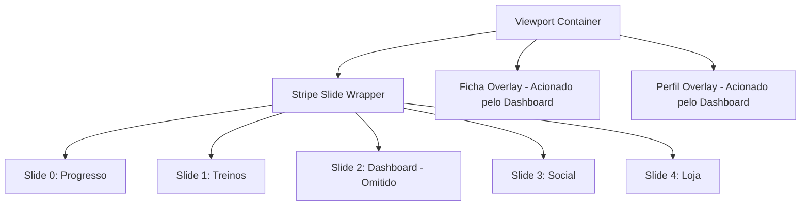

# 🎨 Manual do Sistema de Design (Design System Guide) — Academia PWA

Este documento serve como a **Bíblia de Estilo e Guia de Referência do Sistema de Design** para o aplicativo **Academia Workout Tracker PWA**. Ele cataloga detalhadamente todos os padrões visuais, tokens de design, layouts modulares, componentes, efeitos e animações que compõem a interface imersiva e de alto engajamento do aplicativo (excetuando a tela Dashboard).

---

## 📖 0. Como ler este documento (convenções de caminho)

> **Leia isto antes de usar qualquer caminho citado abaixo.** O documento mistura, historicamente, duas convenções de caminho. A partir de 2026-10-18 a regra é:

| Convenção | Significado | Exemplo |
| :--- | :--- | :--- |
| **Com prefixo `src-app/`** | Caminho relativo à **raiz do repositório** — app React atual (`src-app/`) | `src-app/src/styles/shell.css` |
| **Sem prefixo `src-app/`** | Caminho relativo a **`Legacy/`** (Vanilla JS congelado) — **[LEGADO]** | `style/treino/1-core.css` = `Legacy/style/treino/1-core.css` |
| **Com prefixo `Diretrizes/`** | Documentação em `Diretrizes/` | `Diretrizes/Ícones.md` |

**Regra de ouro:** se o caminho **não** começa com `src-app/`, `Diretrizes/`, `Planos/` ou `Referências/`, ele é do **legado** (`Legacy/`). Seções marcadas com `[LEGADO]` no título descrevem CSS/JS que **não roda** no app React — servem apenas como referência visual/histórica. Para o app atual, consulte a §15 (Mapa de UI) e `system_map.json → ia_quick_reference.atual_src_app`.

---

## 📖 1. Filosofia de Design e Estética Geral

O sistema visual do Academia PWA é guiado pela **Estética Gamificada de Alto Engajamento (High-Engagement Gamification)**. Ele extrai referências visuais de três fontes principais:
1. **Clash Royale (Supercell):** Estrutura de decks de cartas tridimensionais, sub-abas em abas "coladas", modais de conquistas e medalhas com escudos poligonais, e sistema de Tiers de Maestria (Bronze, Prata, Ouro, Elite) com animações holográficas.
2. **Call of Duty / Black Ops (Activision):** Telas de customização de perfil ("Player Cards"), vitrines de títulos desbloqueáveis, molduras circulares de avatar, emblemas animados premium e banners texturizados/animados baseados em conquistas.
3. **Stellar Sci-Fi / Cyberpunk:** Fundos escuros profundos (dark-mode puro), elementos translúcidos (glassmorphism), efeitos de partículas de elixir flutuantes e brilhos neon concentrados nas cores roxo-elétrico e verde-neon.

### Diretrizes de Consistência Visual
*   **Aparência Premium:** Nenhum elemento deve parecer um componente nativo simples do navegador. Use bordas gradientes, sombras suaves compostas e reflexos internos para criar profundidade.
*   **Interface Dinâmica:** Todos os estados de interação (hover, active, focus) devem possuir micro-animações fluidas, lifts no eixo Z e transições de drop-shadow.
*   **Proibição de Imagens Estáticas Básicas:** placeholders cinzas vazios são substituídos por esqueletos premium brilhantes (`.premium-placeholder`) ou demonstrações dinâmicas de GIFs controladas pelo Service Worker.

---

## 💎 2. Tokens de Design (Core & Variáveis Globais)

Todas as variáveis visuais centrais são definidas no seletor `:root` de `style/treino/1-core.css` e `style/main.css`. Elas servem como a fonte única da verdade para temas e especificidades.

### 2.1 Tabela de Cores do Tema

| Variável CSS | Cor Hex/RGBA | Utilização Principal |
| :--- | :--- | :--- |
| `--primary` | `#8b5cf6` | Roxo principal para elementos de destaque e botões primários. |
| `--primary-light` | `#c084fc` | Roxo claro para textos destacados e efeitos de glow (brilho). |
| `--primary-dark` | `#6d28d9` | Roxo escuro para gradientes de fundo e bordas concentradas. |
| `--primary-lighter`| `#ddd6fe` | Roxo muito claro para contrastes de texto secundário. |
| `--accent` | `#f5a6d3` | Rosa acentuado para variações de gradiente alternativo. |
| `--gym-green` | `#22c55e` | Verde neon de confirmação, checklists e sucessos. |
| `--gym-green-glow`| `rgba(34,197,94,0.3)`| Sombra de brilho para elementos ativos com o tom verde. |
| `--background` | `#121212` | Fundo principal da aplicação (subscrito pelo fundo dinâmico). |
| `--background-alt` | `#1f1f1f` | Fundo alternativo para trilhas e inputs secundários. |
| `--card-bg` | `rgba(10,5,20,0.6)`| Fundo glassmorphism padrão de cartões com opacidade. |
| `--card-border` | `rgba(139,92,246,0.25)`| Borda roxa translúcida inicial de cartões. |
| `--card-hover` | `rgba(139,92,246,0.35)`| Fundo do cartão ao passar o cursor. |
| `--text` | `#ffffff` | Branco brilhante para texto principal. |
| `--text-secondary`| `#cccccc` | Cinza claro para textos de leitura secundários. |
| `--text-tertiary` | `#999999` | Cinza escuro para metadados, unidades e subtextos. |
| `--border` | `rgba(139,92,246,0.3)`| Borda global roxa padrão. |
| `--overlay` | `rgba(139,92,246,0.1)`| Sobreposição roxa suave para houver de botões. |

### 2.2 Gradientes e Sombras

```css
/* Gradientes Principais */
--gradient: linear-gradient(135deg, #8b5cf6, #6d28d9);        /* Roxo Royal */
--gradient-alt: linear-gradient(135deg, #fff, #f5a6d3, #8b5cf6); /* Holográfico */
--gradient-hover: linear-gradient(135deg, #a78bfa, #8b5cf6);  /* Hover Primário */
--gradient-gold: linear-gradient(135deg, #fbbf24, #d97706);   /* Dourado Maestria */

/* Brilho Concentrado (Glow) */
--glow: rgba(139, 92, 246, 0.6);
--shadow: rgba(139, 92, 246, 0.3);
--shadow-dark: rgba(139, 92, 246, 0.5);

/* Sistema Modular de Sombras */
--shadow-sm: 0 1px 2px 0 var(--shadow-light);
--shadow-md: 0 4px 6px -1px var(--shadow);
--shadow-lg: 0 10px 15px -3px var(--shadow);
--shadow-xl: 0 20px 25px -5px var(--shadow-dark);
--shadow-2xl: 0 25px 50px -12px var(--shadow-dark);
```

### 2.3 Tipografia
*   **Família de Fontes Principal:** `'Rajdhani', -apple-system, BlinkMacSystemFont, 'Segoe UI', sans-serif`. A fonte Rajdhani (carregada localmente para suporte offline total) é uma fonte condensada de estilo futurista e geométrico, ideal para numerais grandes e títulos de seções gamificadas.
*   **Família de Fontes Secundária:** `'Inter', sans-serif` ou `'Outfit', sans-serif` para campos de formulário e textos corridos onde a legibilidade é primordial.
*   **Escala Tipográfica:**
    *   `h1`: `clamp(2.5rem, 6vw, 4rem)` (Títulos gigantes de Hero)
    *   `h2`: `clamp(2rem, 4vw, 3rem)` (Títulos de seções principais)
    *   `h3`: `1.5rem` (Cabeçalhos de cartões)
    *   `h4`: `1.125rem` (Subseções e títulos de metadados)
    *   `p`: `1rem` (Textos de descrição com `line-height: 1.8` e cor `--text-secondary`)

### 2.4 Espaçamentos, Cantos e Z-Index
*   **Escala de Espaçamento (`--spacing-*`):**
    *   `xs`: `0.5rem` (4px) | `sm`: `1rem` (8px) | `md`: `1.5rem` (16px) | `lg`: `2rem` (24px) | `xl`: `3rem` (32px)
*   **Arredondamento de Cantos (`--radius-*`):**
    *   `sm`: `0.375rem` (6px) | `md`: `0.5rem` (8px) | `lg`: `0.75rem` (12px) | `xl`: `1rem` (16px) | `2xl`: `1.5rem` (24px)
*   **Camadas Visuais (Z-Index):**
    *   `--z-dropdown`: `100` | `--z-sticky`: `200` | `--z-fixed`: `300` | `--z-modal`: `400` | `--z-tooltip`: `500`

---

## 🌌 3. Fundo Dinâmico e Sistema de Partículas (Arena BG) [LEGADO]

O fundo da aplicação não é um padrão cinza escuro estático. Ele adota um sistema de arena viva, com efeito Ken Burns em paralaxe, overlays de atenuação e fluxo ascendente de partículas baseadas em elixir.

```html
<div id="cr-dynamic-bg" class="cr-bg-container">
    <div class="cr-bg-layer"></div>
    <div class="cr-bg-particles">
        <div class="cr-particle cr-p1"></div>
        <div class="cr-particle cr-p2"></div>
        <div class="cr-particle cr-p3"></div>
        <div class="cr-particle cr-p4"></div>
        <div class="cr-particle cr-p5"></div>
    </div>
    <div class="cr-bg-overlay"></div>
</div>
```

### 3.1 Especificações da Arena Viva (`style/treino/secoes/bg-dinamico.css`)
*   **Imagem de Fundo Ken Burns:** `.cr-bg-layer` carrega a arte de textura `Assets/BG/BG-roxo-vertical.jpg` (ou a versão `horizontal.jpg` se orientada em paisagem). Possui animação infinita de zoom e translação suave (`crKenBurns`), saturada em `0` (tons de cinza/preto no fundo) com brilho de `0.6` para destacar os elementos de primeiro plano.
*   **Overlay Glassmorphic:** `.cr-bg-overlay` aplica um gradiente vertical translúcido cinza-escuro com filtro de desfoque `backdrop-filter: blur(3px)` para fundir as bordas da tela.
*   **Partículas Ascendentes:** Cinco partículas independentes (`.cr-p1` a `.cr-p5`) com larguras e durações de animação variadas (7s a 16s) sobem verticalmente rotacionadas em 25 graus, com blur aplicado e gradiente esvanecente. Elas imitam o fluxo de Elixir de Clash Royale.
*   **Desfoque do Contexto:** Quando um modal é exibido, a classe `.bg-blurred` é injetada no container de fundo. Isso aumenta o desfoque da arena de fundo para `8px` e altera o overlay para um cinza escuro de `0.6` de opacidade.

### 3.2 Variações de Matiz por Tema (Recoloração Dinâmica)
Para evitar o carregamento de várias imagens pesadas para diferentes cores de fundo, o sistema de temas aplica o filtro de rotação de matiz (`hue-rotate`) sobre a textura base da arena.

*   💜 **Tema Roxo (Padrão):** Sem filtro.
*   🩵 **Tema Turquesa:** `filter: hue-rotate(265deg) saturate(1.2) brightness(1.1);`
*   ❤️ **Tema Carmesim:** `filter: hue-rotate(75deg) saturate(1.2) brightness(1.1);`
*   💚 **Tema Verde Selva:** `filter: hue-rotate(205deg) saturate(1.2) brightness(1.1);`
*   💙 **Tema Azul Pico:** `filter: hue-rotate(295deg) saturate(1.2) brightness(1.1);`
*   💛 **Tema Ouro:** `filter: hue-rotate(130deg) saturate(1.5) brightness(1.2);`
*   🤎 **Tema Marrom Terra:** `filter: hue-rotate(120deg) saturate(0.5) brightness(0.9);`
*   🧡 **Tema Laranja Lava:** `filter: hue-rotate(115deg) saturate(1.5) brightness(1.1);`
*   🖤 **Tema Cinza Castelo:** `filter: saturate(0) brightness(0.8);`

---

## 📱 4. Navegação Principal e Swipe Viewport [LEGADO]

O aplicativo é estruturado como uma SPA (Single Page Application) controlada por gestos de arrastar para o lado (Swipe Viewport) e botões de atalho na base (Bottom Nav Bar).



### 4.1 Estrutura do Shell (`treino.html`)
*   **`.section-viewport`:** O contêiner de exibição. Possui largura e altura de 100% com `overflow: hidden` para mascarar os slides laterais.
*   **`.section-strip`:** Uma fita horizontal contínua contendo todos os slides enfileirados. Ela se move horizontalmente no eixo X via propriedade `transform: translateX(...)` com transições suaves controladas por `JS/treino/nav.js`.
*   **`.section-slide`:** Cada slide individual com `flex-shrink: 0`, largura de `100vw` e altura de `100%`. Os fragmentos HTML são injetados de forma assíncrona pelo `loader.js` nestes contêineres.

### 4.2 Barra de Navegação Inferior (`.bottom-nav`)
*   **Layout:** Fixada na base da tela (`position: fixed`), possui fundo escuro de opacidade `0.9` e desfoque pesado `backdrop-filter: blur(16px)`.
*   **Glow Ativo de Ícone SVG:** Quando um botão da navegação `.bnav-btn` recebe a classe `.active`, o ícone interno SVG sofre transição de cor para `--primary-light` e ganha um brilho sutil via `filter: drop-shadow(0 0 6px var(--primary))`.
*   **Dot Ativo:** Um pequeno círculo indicador (`.bnav-active-dot`) posicionado na base de cada botão do menu é exibido com escala expandida quando o slide está selecionado, garantindo retorno visual rápido.

---

## 🗂️ 5. Sistema de Abas, Sub-abas e Switches Estilo iOS [LEGADO]

O Academia PWA gerencia múltiplos níveis de navegação interna nos slides (como no slide de Perfil e Treinos/Montar).

### 5.1 Abas Principais Estilo Clash Royale (`style/treino/secoes/tabs-subnav.css`)
Nas seções onde as abas superiores organizam subconjuntos de recursos (ex: Exercícios vs. Montar Ficha), as abas se integram diretamente à borda superior do painel de conteúdo.

*   **Estrutura da Barra:** `.treino-tab-nav` é transparente, eliminando sombras pesadas para colidir diretamente com a caixa de conteúdo.
*   **Aba Ativa com Entalhe (Active Tab):** Quando `.t-tab-btn` é ativada (`.active`), ela sofre transformações exclusivas:
    *   Recebe o fundo escuro da caixa interna de conteúdo (`#150b24`).
    *   Sua borda de contorno é unida ao painel por uma borda de fundo contínua.
    *   O preenchimento superior aumenta (`padding-top: 16px`), dando um efeito tridimensional de aba "colada" que salta para fora.
*   **Painel Integrador (`.perf-tab-content-wrapper`):** Um invólucro unificado com borda roxa de `2px solid rgba(139, 92, 246, 0.3)`, cantos arredondados inferiores (`border-radius: 0 0 24px 24px`) e sombra de projeção profunda.

### 5.2 Sub-Navbar Deslizante (Sub-Nav Dots)
*   **Dot Navigation (`.cr-tab-nav-dots`):** Utilizada no carrossel de metas. Apresenta botões circulares compactos (`.cr-dot`). O dot ativo (`.cr-dot.active`) expande em escala para `1.5`, ganha coloração amarela (`#fde047`) e pulsa via keyframe `stellarPulse`.
*   **Sub-Navbar com Seta Acoplada (`.sub-navbar`):** Linha fina horizontal de botões compactos. O botão selecionado `.sub-nav-btn.active` ganha fundo de gradiente roxo concentrado e projeta um indicador triangular descendente em seu pseudo-elemento `::after` usando truques de borda CSS.

### 5.3 iOS Toggle Switches (`.pref-switch`)
Nas telas de configurações de preferências de treino no Perfil, os botões liga/desliga convencionais são substituídos por seletores deslizantes iOS.

```html
<label class="pref-switch">
    <input type="checkbox" checked>
    <span class="pref-slider"></span>
</label>
```
*   **Visual do Slider:** `.pref-slider` atua como a pista arredondada. Possui fundo cinza translúcido escuro de cantos arredondados completos e borda fina de opacidade.
*   **O Botão Deslizante (`::before`):** Um círculo branco perfeito e brilhante, com sombra projetada suave.
*   **Estado Ativo (Checked):** Quando ativado, a pista transiciona suavemente para a cor roxa `--primary`, e o círculo branco é transladado no eixo X em `20px` usando transição tridimensional acelerada por hardware:
    `transform: translateY(-50%) translateX(20px);`

---

## 🎴 6. Cartões de Exercício, Metas e Views de Ficha [LEGADO]

Os exercícios de treino são representados como cartões tridimensionais colecionáveis que imitam as cartas do jogo Clash Royale.

### 6.1 A Anatomia do Cartão Royale (`.deck-card`)

```
+------------------------------------------+
|  NÍVEL DO EXERCÍCIO (Ex: Nível 8)        |  <-- .deck-card-header (Fundo escuro 40%)
+------------------------------------------+
|                                          |
|                 IMAGEM                   |
|                   OU                     |  <-- .deck-card-img
|               GIF ATIVO                  |
|                                          |
+------------------------------------------+
|          NOME DO EXERCÍCIO               |  <-- .deck-card-name (Rajdhani Negrito)
|               SÉRIES                     |  <-- .series-wrap-deck (Botões 1, 2, 3, 4)
+------------------------------------------+
```

*   **Fundo e Bordas:** `.deck-card` usa um gradiente de fundo inclinado em 145 graus (`linear-gradient(145deg, #1e293b, #0f172a)`), cantos curvos de `14px` e borda fina translúcida de `1px`.
*   **Prévia do Início (v4.33.0):** a **prévia da ficha do dia** no Início **reusa esta mesma anatomia** (card `linear-gradient(145deg, #1e293b, #0f172a)` + borda branca 10%, header `rgba(0,0,0,.4)`) dentro do contêiner `.dash-arena-card`, que adota o **tom de preto da aba Minha Ficha** (`var(--card-bg)` + `var(--card-border)`, o par do `.deck-builder-container`). Era o único lugar que ainda usava o **violeta fixo do antigo "radar fit"** (gradientes `rgba(27,10,43,.8)`→`rgba(13,4,22,.95)` e `#0e0d1a`→`#07060d`, cards `rgba(21,20,40,.85)` + borda `#23223f`, widgets `rgba(21,20,40,.75)` + `#23223f`): o roxo fixo saiu e restou o **acento do tema** apenas onde é interação (hover, outline de destaque do TREINAR, ícone de cardio via `--primary-light`).
*   **Cor do grupo muscular na prévia (v4.34.0):** cada card da **prévia da ficha do dia** exibe a **faixa de topo na cor do seu grupo muscular** (`.dash-mini-deck__grid .deck-card.card-Peito|Costas|Pernas|Ombros|Bíceps|Tríceps|Core`), com a **mesma tabela de cores do `cards.css`** — um grupo muscular tem **uma cor no app inteiro** (a tabela deixou de ser duplicada). As regras existiam desde a v4.30.0 escritas **em minúsculas** (`.card-peito`) enquanto o DOM escreve `card-Peito` (`card-${exercise.muscleGroup}`): nunca casaram, e a prévia ficava sem as faixas que a aba Minha Ficha já tinha. A `--card-glow` de cada grupo também é declarada aqui.
*   **Seletor de ficha da barra inferior (v4.34.0):** a **letra do treino** (A/B) deixou o selo roxo sobre a miniatura e mora na **mesma linha do "N ex"**, em **cinza** (`rgba(255,255,255,.5)`): a linha do card fica **"TREINO" / "A 5 ex"** (`.dash-workout-ex-letter` dentro do `.dash-workout-ex-count`, que virou flex com `align-items: baseline`).
*   **Efeito Hover com Lift 3D:** Ao passar o mouse, o cartão se eleva no eixo Y (`transform: translateY(-8px) scale(1.02)`) com curva de aceleração elástica `cubic-bezier(0.175, 0.885, 0.32, 1.275)` e emite um brilho colorido correspondente à sua categoria na borda.
*   **Brilhos Temáticos por Categoria Muscular** (valores reais do `cards.css` desde a v4.34.0 — a tabela antiga abaixo estava defasada; a **mesma cor** vale para a aba Minha Ficha **e** para a prévia do Início):
    *   🔴 **Peito:** Borda superior vermelha (`#ef4444`) e glow vermelho.
    *   🟢 **Costas:** Borda superior verde (`#22c55e`) e glow verde.
    *   🔵 **Pernas:** Borda superior azul (`#3b82f6`) e glow azul.
    *   🟡 **Ombros:** Borda superior âmbar (`#f59e0b`) e glow âmbar.
    *   💗 **Bíceps:** Borda superior rosa (`#ec4899`) e glow rosa.
    *   🟣 **Tríceps:** Borda superior violeta (`#8b5cf6`) e glow violeta.
    *   ⚫ **Core:** Borda superior cinza-slate (`#64748b`) e glow cinza.
    *   🔷 **Aeróbico** (linha/card de cardio, não é grupo muscular): ciano (`#06b6d4`).

### 6.2 Menu Ativo Tridimensional do Cartão (`.deck-card.menu-active`)
Quando o atleta clica sobre o cartão, ele exibe um menu de opções acoplado na base, exatamente como no deck de cartas de Clash Royale.

*   **Comportamento de Camada:** O cartão recebe a classe `.menu-active`, elevando seu `z-index` para `100` e forçando o container a desativar a máscara de recorte (`overflow: visible`).
*   **Painel de Ações Acoplado:** O `.deck-card-menu` surge da borda inferior com fundo roxo escuro concentrado `#1a0b2e`, borda de `3px solid var(--primary)` nas laterais e base, e correções de margem para travar no cartão.
*   **Botões de Ação Dinâmicos:** Três botões com animações de deslizamento (`buttonSlideUp`) e atraso de entrada escalonado (Stagger Delay):
    1.  `.btn-card-details` (Detalhes): Gradiente roxo suave. Hover projeta sombra roxa de `25px`.
    2.  `.btn-card-maestria-mini` (Desafios): Gradiente dourado. Escrita amarela brilhante `#fde047`.
    3.  `.btn-card-remove` (Remover): Gradiente vermelho com escrita rosa claro.

### 6.3 Modos de Visualização de Treino (`style/treino/secoes/cards.css`)
*   **Royale View (Compact 2x4):** Um grid de 4 colunas compacto (`grid-template-columns: repeat(4, 1fr)`) ideal para visualizar todos os 8 exercícios de uma vez como cartas de baralho na tela do celular. Adapta os tamanhos de fonte e remove paddings excessivos.
*   **List View (Lista Estendida):** Exibe as cartas esticadas como barras longitudinais (`.deck-list-item`) com imagem quadrada de `50px` à esquerda, títulos de maestria e controles rápidos de séries alinhados horizontalmente.
*   **Grid View (Padrão):** Grid flexível auto-adaptável (`minmax(240px, 1fr)`) que preenche a tela dependendo do tamanho do dispositivo.

### 6.4 Design de Exercício Aeróbico / Cardio (`style/treino/4-gamificacao.css`)
*   **Visual de Pista de Corrida:** O cartão de aeróbico (`.ex-card-aerobico`) tem visual refinado com gradiente verde suave (`#22c55e`).
*   **Ícone Animado:** O `.ae-icon` (tênis de corrida ou coração) tem animação de balanço contínuo (`aeRun`) para incitar movimento.
*   **Metas de Desempenho:** Caixas estatísticas separadas por divisores cinza finos contendo valores em destaque verde contendo velocidade (`km/h`), tempo (`min`) e distância (`km`).
*   **Linha do cardio:** no card (`.ae-card-head`) e na tabela (`.ae-table-cardio`) o rótulo **CARDIO** fica à esquerda e o tipo escolhido à direita, na mesma linha e com a mesma tipografia (tamanho, peso, cor e família herdada) — o nome do cardio é o destaque, não o rótulo.

---

## 🎖️ 7. Sistema de Maestria (Tiers, Molduras e Escudos) [LEGADO]

O sistema de Maestria quantifica a dedicação do atleta a cada exercício em tiers estruturados de conquistas, imitando o layout de Clash Royale.

### 7.1 Pip Badges de Categoria (`.m-badge-pip`)
Pequeno indicador flutuante que exibe a insígnia de metal correspondente ao nível de maestria do movimento:
*   `none` (Sem maestria): Cinza opaco.
*   `bronze` (Bronze): Tom cobre `#cd7f32` com brilho de sombra.
*   `prata` (Prata): Prateado metálico `#c0c0c0`.
*   `ouro` (Ouro/Elite): Dourado brilhante `#ffd700` com glow projetado.

### 7.2 Modal Geral de Maestria (`style/treino/6-maestria.css`)
Um painel expansível gigante (`.maestria-geral-container`) com desfoque de fundo de `40px`, fundo escuro estrelado composto por padrão de grade de pontos cinza translúcidos (`::before` radial-gradient) e grade de rolagem contendo todos os cartões.

#### Royale Tiers & Molduras de Cartões (`.royale-card`)
As molduras dos cartões de maestria refletem os materiais preciosos do tier:
1.  **Frame Bronze:** Linha dourada-cobre de gradiente `#fb923c` a `#7c2d12`. Hover ativa blur de dispersão acobreado.
2.  **Frame Prata:** Linha cinza metalizada de gradiente `#e2e8f0` a `#475569`.
3.  **Frame Ouro Elite (Holográfico):** Moldura dourada rica `#fde047` com gema flutuante que pulsa (`gemPulse`).
    *   **Efeito Holográfico:** A camada interna do escudo de ouro possui um pseudo-elemento `::after` com gradiente diagonal branco translúcido que desliza infinitamente da esquerda para a direita (`holoShine`), recriando o reflexo de cartas holográficas físicas.

### 7.3 Modal Individual e Escudos Poligonais
O modal de maestria por exercício (`.maestria-ex-container`) apresenta uma insígnia gigante na parte superior.

*   **Escudo de Maestria Poligonal (`.royale-badge-shield`):** Uma caixa com cantos e base cortados em ângulo simulando um escudo medieval clássico. Isso é alcançado usando corte de vetor CSS moderno:
    `clip-path: polygon(0% 0%, 100% 0%, 100% 85%, 50% 100%, 0% 85%);`
*   **Linha de Evolução Estelar (`.mx-badge-stars`):** Conjunto de três estrelas SVG na base do escudo. Elas se acendem (`.lit`) em cor ouro brilhante com drop-shadow concentrado conforme o atleta avança os níveis do desafio.
*   **Desafios Deslizantes (`.royale-task-row`):** Linhas de metas com barra de progresso dourada acentuada e abas indicadoras de nível à direita (`.level-tab.active`) que piscam suavemente no nível corrente.

### 7.4 Avatar do Início, molduras e foto de perfil (v4.56.2)
*   **Avatar/emblema REDONDO:** `legacy-style/treino/secoes/dashboard.css` — `.dash-profile-avatar.profile-avatar` usa `border-radius: 50%` no contêiner, na `` e no `.profile-avatar__emblem-wrapper` (também no breakpoint mobile).
*   **Moldura segue a escolha:** o `data-frame` do banner do Início vem de `customization.avatarFrame`, escolhido na sub-aba **Emblema** (antes "Maestrias") da seção Treinos. As molduras são escolha livre (`AVATAR_FRAMES` com `unlock: null`, sem revert). O anel é pintado no **contêiner**: sem moldura ele é neutro (`border: 2px solid rgba(255,255,255,.16)` + sombra escura) e `[data-frame="bronze|prata|ouro|elite"]` troca `border-color` e glow no acento do tier (bronze `#f97316`, prata `#94a3b8`, ouro `#fbbf24`, elite `var(--primary)`). Os outlines internos de `img`/`svg`/`.profile-avatar__emblem-wrapper` são zerados para não duplicar o anel.
*   **Foto de perfil:** a sub-aba Emblema tem upload (`.profile-photo-picker`) que grava `customization.photo` (480 px JPEG) — mesma prioridade sobre o emblema usada por `ProfileEmblem`, avatar do Início, sidebar, drawer e Fit ID; o OAuth do Google só sobrescreve quando a foto ausente ou é do Google. A foto e as métricas de corpo não usam `localStorage`: as métricas estão no banco (ver §16.9).

---

## 🎨 8. Personalização do Perfil (Banners e Emblemas COD-Style) [LEGADO]

Inspirado nos menus de customização estética de Call of Duty, o perfil do usuário pode ser remodelado usando banners, molduras, títulos e emblemas.

### 8.1 Catálogo de Banners Estáticos de Fundo (`.profile-banner`)

| ID do Banner | Gradiente / Cores Base | Efeitos de Textura Aplicados |
| :--- | :--- | :--- |
| `roxo-neon` | Linear Gradient Roxo-Neon escuro. | radial-gradient de iluminação suave nos cantos. |
| `aurora` | Tons profundos de azul marinho e verde-esmeralda. | Pontos brilhantes simulando a aurora boreal. |
| `fogo-eterno`| Gradiente de fogo de vermelho escuro a laranja. | Oscilação constante de opacidade (`bannerFlicker`). |
| `ouro-elite` | Dourado envelhecido a amarelo ouro. | Linhas diagonais repetidas douradas translúcidas. |
| `ciberespaco`| Tons pretos, ciano e roxo digital. | Linhas horizontais de varredura CRT de fósforo. |
| `shadow-ops` | Preto absoluto e cinza escuro de baixa saturação.| Iluminação central sutil de foco único. |
| `aco-frio` | Cinza chumbo e azul-cinzento de alto contraste. | Brilho radial nos cantos estilo chapa metálica. |
| `dragao-ouro`| Vermelho carmesim profundo, marrom e amarelo ouro. | Dois pontos de iluminação opostos (ouro e vermelho). |

### 8.2 Banners Animados Premium (`style/treino/8-customizacao.css`)
Disponíveis para usuários Pro ou conquistados por desafios, estes banners usam propriedades CSS modernas.

1.  **Plasma Elétrico (`data-banner="plasma"`):** Apresenta uma linha de conic-gradient que rotaciona 360 graus de forma contínua no eixo central. Usa `@property --angle` registrada para animar gradientes cônicos sem distorções no navegador:
    ```css
    @property --angle {
      syntax: '<angle>';
      initial-value: 0deg;
      inherits: false;
    }
    ```
2.  **Aurora Viva (`data-banner="aurora-viva"`):** Deslocamento suave bidimensional de duas nuvens radiais verdes e ciano com filtro de desfoque e mesclagem `color-dodge`.
3.  **Vulcão (`data-banner="vulcao"`):** Três esferas brilhantes na base com animação vertical `lavaPulse` simulando calor e ascensão de magma.
4.  **Matrix (`data-banner="matrix"`):** Linha horizontal ciano-esmeralda com sombra de varredura descendente contínua (`cyberScan`) sob padrão de grade cibernética fixa.
5.  **Nebulosa (`data-banner="nebulosa"`):** Duas grandes nuvens circulares rosa e roxa que rotacionam e orbitam em sentidos opostos com desfoque de `25px`.

### 8.3 Molduras de Avatar
*   `bronze` / `prata` / `ouro`: Contorno grosso circular de `3px solid` com cores de metais preciosos correspondentes e deslocamento externo `outline-offset: 2px`.
*   `elite`: Emite um anel de brilho roxo contínuo e intenso usando sombra múltipla.

### 8.5 Emblemas Animados Premium (`.emblem-gallery`)
*   **Pulse Glow (`.emblem-gallery__icon--pulse-glow`):** O ícone expande e contrai de forma rítmica enquanto sua iluminação aumenta de tamanho.
*   **Spin 3D (`.emblem-gallery__icon--spin-slow`):** Rotaciona o ícone tridimensionalmente no eixo Y usando perspectiva de câmera simulada pelo CSS:
    `transform: perspective(400px) rotateY(360deg);`
*   **Hellfire (`.emblem-gallery__icon--flicker`):** Oscilação de escala, posição vertical e dispersão de sombra vermelha e laranja simulando chamas oscilantes.

---

## ⏱️ 9. Temporizadores de Descanso (Radar e Ampulheta) [LEGADO]

O Academia PWA possui um timer de descanso inteligente que flutua na tela de forma não intrusiva. Ele possui dois layouts visuais altamente polidos selecionáveis nas preferências.

### 9.1 Container Flutuante (`.rest-timer`)
*   **Aparência:** Uma pílula flutuante arredondada posicionada no centro inferior da tela (`left: 50%; transform: translateX(-50%)`).
*   **Design Premium:** Borda escura `#333`, fundo preto opaco `0.95` com desfoque de fundo e sombra de projeção massiva. Quando o tempo está correndo, a classe `.rt-running` acende uma borda roxa brilhante ao redor do cronômetro.

### 9.2 Modo Radar (`.timer-radar` / `style/treino/2-modals.css`)
Simula uma varredura de radar militar tático.

*   **Pista Circular:** Um círculo perfeito com gradiente radial verde-limão translúcido e grade de cruzamento vertical (`.ch-v`) e horizontal (`.ch-h`) com marcas de escala nas pontas.
*   **Varredura Cônica (Radar Sweep):** O preenchimento do tempo restante é desenhado por um gradiente cônico circular (`conic-gradient`) cuja porcentagem é injetada de forma reativa pelo Javascript na variável CSS `--progress`. O gradiente transita de um verde limão brilhante com blur para a transparência absoluta.
    `background: conic-gradient(rgba(204,255,0,0.8) var(--progress, 0%), transparent 0%);`

### 9.3 Modo Ampulheta (`.timer-hourglass`)
Carrega um vetor SVG dinâmico representando uma ampulheta física estilizada em tons vermelhos e pretos.
*   **Animação da Areia:** O esvaziamento da areia do bulbo superior e o preenchimento do bulbo inferior são controlados de forma proporcional alterando os atributos de escala visual e opacidade dos paths do SVG via código JavaScript, criando uma transição mecânica imersiva.

---

## 🎨 10. Manual de Ícones SVG (Resumo de Diretrizes) [LEGADO]

Todos os ícones das abas, botões e cabeçalhos seguem estritamente as diretrizes contidas em `Diretrizes/Ícones.md`.

*   **Filosofia Vetorial:** Uso exclusivo de SVGs inline de contorno (estilo Lucide/Feather). É expressamente proibido o uso de emojis na UI ativa ou fontes de terceiros misturadas.
*   **Atributos Base Obrigatórios:**
    ```html
    <svg viewBox="0 0 24 24" fill="none" stroke="currentColor" 
         stroke-width="2" stroke-linecap="round" stroke-linejoin="round">
        <!-- paths vetoriais -->
    </svg>
    ```
*   **Controle de Cor:** A propriedade `stroke` é sempre definida como `currentColor` no vetor. A cor real do ícone é controlada no arquivo CSS do componente pai (geralmente herdando de `--text-secondary` ou `--primary-light`), garantindo conformidade com o sistema de temas dinâmicos do aplicativo.
*   **Exceção de Preenchimento (`fill`):** Apenas o ícone de Play / Iniciar Treino possui preenchimento total (`fill="currentColor"` e `stroke="none"`) para fins de destaque de legibilidade na ficha diária.

---

## 🕹️ 11. Elementos Interativos, Botões e Controles Rápidos [LEGADO]

### 11.1 Botões Primários com Reflexo Radial (`.btn-primary`)
*   **Reflexo Interno:** Possui um pseudo-elemento `::before` contendo um gradiente radial branco translúcido centrado. No estado inicial, a opacidade é zero.
*   **Hover Glow:** Ao passar o mouse, a opacidade do reflexo transiciona para `1`, dando um efeito de vidro iluminado sob o cursor. O botão se desloca `3px` para cima e emite uma projeção de sombra roxa profunda.

### 11.2 Checkbox Gamificado de Conclusão (`.check-wrap`)
Usado nas tabelas de exercícios para marcar séries feitas.
*   **Visual Inicial:** Um quadrado de contorno roxo fosco translúcido sem preenchimento. Hover transita a borda para verde.
*   **Ao Marcar (Checked):** O quadrado preenche instantaneamente com verde neon `--gym-green`, emite uma sombra verde brilhante e o ícone de marcação surge com animação elástica de estouro (`checkPop`):
    `animation: checkPop .3s cubic-bezier(.34,1.56,.64,1);`

### 11.3 Toolbar de Busca Expansível (`.premium-toolbar`)
*   **Campo de Busca Retrátil:** O container de busca `.ex-search-box.collapsible` inicia como um botão quadrado minimalista de `40px` contendo apenas a lupa.
*   **Expansão por Foco:** Ao clicar ou focar no campo, o container expande sua largura suavemente para `240px` via animação cubic-bezier, altera o fundo para roxo ultra escuro e revela o campo de texto de digitação.
*   **Dropdown flutuante de Filtros:** O seletor de categorias se abre como uma cascata glassmorphic elegante logo abaixo do botão de ação, com cantos arredondados finos e setas indicadoras de encaixe no topo.

---

## 🎬 12. Catálogo Completo de Animações (Keyframes CSS) [LEGADO]

O aplicativo utiliza um conjunto unificado de keyframes para garantir consistência de velocidade e curvas de aceleração em todas as seções.

### 12.1 Animações de Entrada e Transição de Telas
```css
/* Entrada de modais e sub-abas com elevação suave */
@keyframes fadeInUp {
    from { opacity: 0; transform: translateY(30px); }
    to   { opacity: 1; transform: translateY(0); }
}

/* Deslizamento lateral de elementos secundários à esquerda */
@keyframes slideInLeft {
    from { opacity: 0; transform: translateX(-50px); }
    to   { opacity: 1; transform: translateX(0); }
}

/* Transição de abertura de abas de perfil */
@keyframes perfTabIn {
    from { opacity: 0; transform: translateY(6px); }
    to   { opacity: 1; transform: translateY(0); }
}
```

### 12.2 Efeitos de Brilho e Placeholders
```css
/* Pulso de contorno e sombras internas do placeholder premium */
@keyframes exPulse {
    0%, 100% {
        box-shadow: inset 0 0 30px rgba(139, 92, 246, 0.2), 0 0 10px rgba(139, 92, 246, 0.1);
        border-color: rgba(139, 92, 246, 0.3);
    }
    50% {
        box-shadow: inset 0 0 40px rgba(139, 92, 246, 0.4), 0 0 20px rgba(139, 92, 246, 0.3);
        border-color: rgba(139, 92, 246, 0.6);
    }
}

/* Brilho metálico diagonal contínuo (Shimmer) */
@keyframes exShimmer {
    0%   { transform: translate(-30%, -30%) rotate(45deg); }
    100% { transform: translate(30%, 30%) rotate(45deg); }
}

/* Flutuação suave em suspensão de ícones grandes */
@keyframes exFloat {
    0%, 100% { transform: translateY(0); }
    50%      { transform: translateY(-6px); }
}
```

### 12.3 Animações de Conquistas e Elementos Especiais
```css
/* Efeito de brilho de varredura holográfica em escudos de Ouro Elite */
@keyframes holoShine {
    0%        { transform: rotate(25deg) translate(-100%, -100%); }
    20%, 100% { transform: rotate(25deg) translate(100%, 100%); }
}

/* Pulsação do troféu dourado na tela de conclusão */
@keyframes trophyPulse {
    0%, 100% { transform: scale(1); }
    50%      { transform: scale(1.1) rotate(-5deg); }
}

/* Fluxo luminoso horizontal de XP na barra do Ciclo */
@keyframes xpFlow {
    0%   { background-position: 0% 50%; }
    100% { background-position: 200% 50%; }
}

/* Balanço contínuo do ícone de cardio correndo */
@keyframes aeRun {
    0%, 100% { transform: translateX(-5px) rotate(-5deg); }
    50%      { transform: translateX(5px) rotate(5deg); }
}
```

### 12.4 Efeito Cascata de Elementos (Staggering)
Para criar uma sensação premium de carregamento, o aplicativo aplica um micro-atraso incremental nos itens de tabelas e listas dinâmica.
Isso é feito em CSS puro multiplicando um índice de variável CSS injetado pelo JavaScript (`--item-index`) por um multiplicador de tempo base:

```css
.stagger-item {
  opacity: 0;
  animation: uiFadeIn 0.32s cubic-bezier(0.25, 1, 0.5, 1) both;
  animation-delay: calc(var(--item-index, 0) * 0.035s);
}
```

---

## 🛠️ 13. Exemplos de Implementação de Componentes (Blueprints) [LEGADO]

Esta seção cataloga os blueprints de marcação (HTML) e estilização (CSS) prontos para uso para cada elemento chave do Academia PWA.

### 13.1 O Cartão de Exercício Clash Royale (`.deck-card`)

```html
<!-- Componente de Exercício Individual de Peito -->
<div class="deck-card badge-Peito stagger-item" style="--item-index: 2;">
    <div class="deck-card-header">
        <span class="card-level">NÍVEL 8</span>
        <span class="m-badge-pip ouro">★ III</span>
    </div>
    <div class="deck-card-img">
        
    </div>
    <div class="deck-card-body">
        <h4 class="deck-card-name">Supino Reto com Barra</h4>
        <div class="series-wrap-deck">
            <span class="btn-series-indicator done">1</span>
            <span class="btn-series-indicator done">2</span>
            <span class="btn-series-indicator">3</span>
            <span class="btn-series-indicator">4</span>
        </div>
    </div>
    <!-- Menu de Ações (Exibido sob clique/foco) -->
    <div class="deck-card-menu">
        <button class="btn-card-action btn-card-details" aria-label="Ver detalhes">
            <svg class="icon-chip" viewBox="0 0 24 24"><path d="M1 12s4-8 11-8 11 8 11 8-4 8-11 8-11-8-11-8z"/><circle cx="12" cy="12" r="3"/></svg>
            DETALHES
        </button>
        <button class="btn-card-action btn-card-maestria-mini" aria-label="Ver maestria">
            🏆 MAESTRIA
        </button>
        <button class="btn-card-action btn-card-remove" aria-label="Remover da Ficha">
            EXCLUIR
        </button>
    </div>
</div>
```

```css
/* CSS do Cartão */
.deck-card {
    position: relative;
    background: linear-gradient(145deg, #180f2b 0%, #0d0617 100%);
    border: 1px solid var(--card-border);
    border-radius: 16px;
    padding: 12px;
    display: flex;
    flex-direction: column;
    gap: 8px;
    cursor: pointer;
    transition: all 0.3s cubic-bezier(0.175, 0.885, 0.32, 1.275);
    overflow: hidden;
}

.deck-card:hover {
    transform: translateY(-8px) scale(1.03);
    border-color: var(--muscle-glow);
    box-shadow: 0 12px 30px rgba(var(--muscle-rgb), 0.3), 0 0 15px rgba(var(--muscle-rgb), 0.2);
}

/* Cores Injetadas por Categoria de Músculo */
.badge-Peito {
    --muscle-glow: #e94560;
    --muscle-rgb: 233, 69, 96;
}
.badge-Costas {
    --muscle-glow: #4ecdc4;
    --muscle-rgb: 78, 205, 196;
}

.deck-card-header {
    display: flex;
    justify-content: space-between;
    align-items: center;
    background: rgba(0, 0, 0, 0.3);
    padding: 4px 8px;
    border-radius: 6px;
}

.card-level {
    font-family: 'Rajdhani', sans-serif;
    font-weight: 800;
    font-size: 0.72rem;
    color: var(--text-secondary);
}

.deck-card-img {
    width: 100%;
    aspect-ratio: 4/3;
    border-radius: 8px;
    background: #000;
    overflow: hidden;
}
.deck-card-img img {
    width: 100%;
    height: 100%;
    object-fit: cover;
}

.deck-card-name {
    font-family: 'Rajdhani', sans-serif;
    font-size: 0.95rem;
    font-weight: 700;
    color: #fff;
    text-transform: uppercase;
    white-space: nowrap;
    overflow: hidden;
    text-overflow: ellipsis;
}

/* Indicadores de Séries Rápidas */
.series-wrap-deck {
    display: flex;
    gap: 6px;
    justify-content: center;
}
.btn-series-indicator {
    width: 24px;
    height: 24px;
    border-radius: 50%;
    border: 1px solid rgba(255,255,255,0.15);
    background: rgba(0, 0, 0, 0.4);
    display: flex;
    align-items: center;
    justify-content: center;
    font-size: 0.75rem;
    font-weight: 800;
    color: var(--text-secondary);
}
.btn-series-indicator.done {
    background: var(--gym-green);
    border-color: var(--gym-green);
    color: #fff;
    box-shadow: 0 0 10px var(--gym-green-glow);
}
```

---

### 13.2 O Seletor Deslizante Estilo iOS (`.pref-switch`)

```html
<!-- Interruptor iOS para Modo Foco Automático -->
<div class="pref-row">
    <span class="pref-label">Avanço Automático de Séries</span>
    <label class="pref-switch">
        <input type="checkbox" id="chkAutoAdvance" checked>
        <span class="pref-slider"></span>
    </label>
</div>
```

```css
/* CSS do Toggle iOS */
.pref-row {
    display: flex;
    justify-content: space-between;
    align-items: center;
    padding: 14px 18px;
    background: rgba(255, 255, 255, 0.02);
    border: 1px solid var(--card-border);
    border-radius: 12px;
}

.pref-label {
    font-size: 0.9rem;
    font-weight: 600;
    color: var(--text-secondary);
}

.pref-switch {
    position: relative;
    display: inline-block;
    width: 46px;
    height: 24px;
}
.pref-switch input {
    display: none; /* Esconde checkbox nativo */
}

.pref-slider {
    position: absolute;
    inset: 0;
    background-color: rgba(255, 255, 255, 0.08);
    border: 1px solid rgba(255, 255, 255, 0.15);
    border-radius: 34px;
    cursor: pointer;
    transition: all 0.3s cubic-bezier(0.4, 0, 0.2, 1);
}

.pref-slider::before {
    content: "";
    position: absolute;
    height: 18px;
    width: 18px;
    left: 2px;
    top: 50%;
    transform: translateY(-50%);
    background-color: #ffffff;
    border-radius: 50%;
    box-shadow: 0 2px 5px rgba(0,0,0,0.4);
    transition: all 0.3s cubic-bezier(0.34, 1.56, 0.64, 1);
}

.pref-switch input:checked + .pref-slider {
    background-color: var(--primary);
    border-color: var(--primary-light);
    box-shadow: 0 0 10px rgba(139, 92, 246, 0.4);
}

.pref-switch input:checked + .pref-slider::before {
    transform: translateY(-50%) translateX(22px);
}
```

---

### 13.3 As Abas Unidas Clash Royale (`.t-tab-btn`)

```html
<!-- Estrutura de Abas Encaixadas -->
<div class="treino-tab-nav">
    <button class="t-tab-btn active" data-tab="ficha-dia">
        <span>Ficha de Hoje</span>
    </button>
    <button class="t-tab-btn" data-tab="montar-ficha">
        <span>Montar Treino</span>
    </button>
</div>
<div class="perf-tab-content-wrapper">
    <!-- Conteúdo da Aba Ativa -->
</div>
```

```css
/* CSS de Abas Encaixadas */
.treino-tab-nav {
    display: flex;
    gap: 6px;
    background: transparent;
    padding: 0 12px;
    margin-bottom: -1px; /* Cola no painel inferior */
    z-index: 2;
    position: relative;
}

.t-tab-btn {
    flex: 1;
    padding: 10px 16px;
    background: rgba(0, 0, 0, 0.4);
    border: 1px solid var(--card-border);
    border-bottom: none;
    border-radius: 12px 12px 0 0;
    color: var(--text-tertiary);
    font-family: 'Rajdhani', sans-serif;
    font-weight: 700;
    font-size: 0.88rem;
    text-transform: uppercase;
    letter-spacing: 1.5px;
    cursor: pointer;
    transition: all 0.25s ease;
}

.t-tab-btn:hover {
    color: #fff;
    background: rgba(139, 92, 246, 0.1);
}

.t-tab-btn.active {
    background: #150b24; /* Mesmo fundo do painel wrapper */
    color: var(--primary-light);
    border-color: var(--border);
    padding-top: 14px; /* "Pula" ligeiramente para fora */
    transform: translateY(0);
    text-shadow: 0 0 8px rgba(139, 92, 246, 0.4);
}

.perf-tab-content-wrapper {
    background: #150b24;
    border: 1px solid var(--border);
    border-radius: 0 0 24px 24px;
    padding: 24px;
    box-shadow: 0 20px 40px rgba(0,0,0,0.6);
}
```

---

### 13.4 O Cronômetro Flutuante de Descanso (`.rest-timer`)

```html
<!-- Painel Flutuante do Cronômetro -->
<div class="rest-timer rt-running" id="blueprintTimer">
    <button class="rt-close">✕</button>
    <div class="rt-visuals">
        <!-- Exemplo de Radar Sweep -->
        <div class="timer-radar">
            <div class="radar-crosshair ch-v"></div>
            <div class="radar-crosshair ch-h"></div>
            <div class="radar-fill" style="--progress: 40%;"></div>
            <span class="rt-time">00:45</span>
        </div>
    </div>
</div>
```

```css
/* CSS do Temporizador Flutuante */
.rest-timer {
    position: fixed;
    bottom: 84px;
    left: 50%;
    transform: translateX(-50%);
    background: rgba(10, 5, 20, 0.95);
    backdrop-filter: blur(12px);
    border: 1px solid #333;
    border-radius: 20px;
    padding: 16px;
    box-shadow: 0 20px 50px rgba(0,0,0,0.8);
    z-index: 300;
    min-width: 130px;
    animation: slideUpTimer 0.3s cubic-bezier(0.34, 1.56, 0.64, 1);
}

.rt-running {
    border-color: var(--primary-light);
    box-shadow: 0 0 25px rgba(139, 92, 246, 0.25);
}

.rt-visuals {
    width: 96px;
    height: 96px;
    position: relative;
    margin: 0 auto;
    display: flex;
    align-items: center;
    justify-content: center;
}

.rt-time {
    font-family: 'Rajdhani', sans-serif;
    font-size: 1.8rem;
    font-weight: 700;
    color: #fff;
    z-index: 5;
    text-shadow: 0 2px 4px #000;
}

/* Pista e Sweep do Radar */
.timer-radar {
    width: 100%;
    height: 100%;
    border-radius: 50%;
    border: 1.5px solid rgba(255, 255, 255, 0.15);
    background: radial-gradient(circle, rgba(204, 255, 0, 0.04) 0%, rgba(0,0,0,0.8) 75%);
    position: relative;
    display: flex;
    align-items: center;
    justify-content: center;
    overflow: hidden;
}

.radar-fill {
    position: absolute;
    inset: 0;
    border-radius: 50%;
    background: conic-gradient(rgba(204, 255, 0, 0.85) var(--progress, 0%), transparent 0%);
    filter: drop-shadow(0 0 6px rgba(204, 255, 0, 0.5));
    opacity: 0.9;
    z-index: 2;
}

.radar-crosshair {
    position: absolute;
    background: rgba(255, 255, 255, 0.08);
    z-index: 3;
}
.ch-v { width: 1px; height: 100%; left: 50%; }
.ch-h { height: 1px; width: 100%; top: 50%; }

.rt-close {
    position: absolute;
    top: 6px;
    right: 8px;
    background: none;
    border: none;
    color: var(--text-tertiary);
    cursor: pointer;
    font-size: 0.9rem;
    z-index: 10;
}
.rt-close:hover { color: #ef4444; }
```

---

### 13.5 O Blueprint de Ícone SVG Padrão (`currentColor`)

```html
<!-- Ícone SVG de Haltere (Dumbbell) Reativo ao Tema -->
<svg class="icon-base" viewBox="0 0 24 24" fill="none" stroke="currentColor" 
     stroke-width="2.5" stroke-linecap="round" stroke-linejoin="round" aria-hidden="true">
    <path d="M6.5 6.5h11" />
    <path d="M6.5 17.5h11" />
    <path d="M12 6.5v11" />
    <circle cx="4" cy="12" r="1.5" />
    <circle cx="20" cy="12" r="1.5" />
</svg>
```

```css
/* CSS do Ícone SVG */
.icon-base {
    width: 20px;
    height: 20px;
    display: inline-block;
    vertical-align: middle;
    flex-shrink: 0;
    transition: stroke 0.2s, filter 0.2s;
}

/* Controlando as cores via herança no CSS pai */
.bnav-btn { color: var(--text-tertiary); }
.bnav-btn:hover { color: var(--text-secondary); }

.bnav-btn.active {
    color: var(--primary-light);
}
.bnav-btn.active .icon-base {
    filter: drop-shadow(0 0 6px var(--primary));
}
```

---

---

## 🆕 16. Features do App Atual (React) — CSS e Componentes

> **Escopo:** seções 3–14 acima são **[LEGADO]** (CSS/JS do Vanilla, referência visual). Esta seção documenta as features que existem **apenas no app React** (`src-app/src/`) e seus padrões de CSS/classes. Caminhos relativos a `src-app/src/`.

### 16.1 Música / Miniplayer
- **Componentes:** `features/music/MusicOverlay.tsx`, `features/music/FloatingMiniPlayer.tsx`, `features/music/WorkoutNowPlayingBar.tsx`, `features/music/player-prefs.ts`, `features/music/background-music.ts`, `features/music/audio-engine.ts`, `features/music/media-store.ts`
- **CSS:** `features/music/music.css`
- **Classes:** `.mu-*` (overlay), `.fmp*` (miniplayer flutuante), `.wnp*` (barra now-playing no treino)
- **Padrões:** player Flexível (painel arrastável) / Fixo (pastilha contador), 6 posições (`PLAYER_POSITIONS`), visibilidade Sempre ativo / Só após trocar, slider de segundos (3–30s), persistência via `player-prefs.ts` + evento `academia:player-prefs-changed`. Contextos de áudio: main (MAIN.mp3 loop) / workout (Black Panther loop) / result (RESULT.mp3 1x) / missions (Revenger Phoenix loop) / workout-user (playlist do usuário).

### 16.2 Social / Ligas / Guildas
- **Componentes:** `features/social/SocialFeature.tsx`, `features/social/LigasFeature.tsx`, `features/social/GuildPanel.tsx`, `features/social/guild-data.ts`
- **CSS:** `features/social/social.css`, `features/social/guild.css`
- **Classes:** `.soc-*` (amigos/perfil), `.ligas-*` (ligas/banner), `.guild-*` (guildas)
- **Padrões:** overlays fullscreen via `createPortal(document.body)`; ligas semanal/mensal em localStorage; guilda com estado local (`academia_guilds_v1`, evento `academia:guild-changed`) — entrar/criar guilda, emblemas = `IDENTITY_EMBLEMS`, membros com funções e troféus. Na sub-aba Guilda o **banner do cabeçalho** (emblema, nome, “X/50 Membros”, na mesma linha do fechar) abre os **detalhes em modal** (`.guild-detail`) e a sub-aba mostra só o chat; sair usa um **diálogo de confirmação** central (`.guild-overlay--dialog`). O formulário de criação segue o padrão de **linhas rótulo à esquerda / controle à direita** (`.guild-form`) com seletores **◀ valor ▶** (`.guild-step`) para tipo e troféus. **Sem doações semanais e sem pontuação do clã** (decisão de produto).

### 16.3 Bloqueio (Lock)
- **Componentes:** `features/lock/LockScreen.tsx`
- **CSS:** `features/lock/lock.css` (z-index 1200)
- **Classes:** `.lock`, `.lock__*`
- **Padrões:** PIN alfanumérico 4–6 dígitos (hash djb2, nunca cru), biometria fake 1s, inatividade chips 1/2/5/10/15/30 min + Sempre Logado, wallpapers neon/grafite/violeta/magenta por orientação (`lock-wallpapers.ts`), badge "Bloqueio Ativo" quando enabled + pinLen>0. Modo "Automática"/"Só no Botão" persiste via `LOCK_PREF_MAP.bioAuto`.

### 16.4 Busca Global
- **Componentes:** `features/search/GlobalSearchOverlay.tsx`
- **CSS:** `features/search/search.css`
- **Classes:** `.gs-*`
- **Padrões:** atalho Ctrl/Cmd+K, índice unificado (exercícios + fichas A–J), normalização de acentos (NFD), ranking com score, grupos ordenados pelo melhor match. Overlay fullscreen via `createPortal`.

### 16.5 Desktop (Sidebar/Drawer)
- **Componentes:** `components/DesktopSidebar.tsx`, `components/MobileDrawer.tsx`, `components/ProfileEmblem.tsx`
- **CSS:** `styles/shell.css` (`.side-hud`, `.mdw__*`, `#desktopSidebar`)
- **Padrões:** Sidebar HUD colapsável (z-index 1100), navegação por seções, badges de notificação, ProfileEmblem, animação slide-in/out, integração `useCrossBrowserFullscreen`. Drawer mobile com overlay scrim.

### 16.6 Fit ID
- **Componentes:** `features/dashboard/FitIdOverlay.tsx`
- **CSS:** `features/dashboard/fitid-overlay.css`
- **Classes:** `.fitid-*`
- **Padrões:** overlay de perfil "Player Card" (Call of Duty style): avatar circular, moldura, banner, títulos desbloqueáveis, emblemas animados. Monta via `createPortal(document.body)`.

### 16.7 Sync / Conta
- **Componentes:** `features/sync/SyncSettingsPanel.tsx`, `features/sync/ConnectedDevices.tsx`, `features/sync/ScreensCustomizationPanel.tsx`, `features/sync/AppLoadingScreen.tsx`, `features/sync/RemoteSyncToast.tsx`
- **CSS:** `features/sync/sync.css`
- **Classes:** `.sync-*`, `.connected-devices`
- **Padrões:** sync multi-dispositivo (Supabase), fila offline (IndexedDB), push/pull (fichas, histórico, maestria, prefs), resolução de conflitos last-write-wins por `updatedAt`, registro de dispositivo (deviceId, nome, platform), preferências cross-device.

### 16.8 Classes CSS novas (app atual)
| Classe | Onde | Descrição |
| :--- | :--- | :--- |
| `.bnav-icon--fill` | `legacy-style/treino/7-nav-icons.css` | Silhueta preenchida (fill) para ícones da barra inferior (halteres FA solid) — normal `rgba(255,255,255,.35)`, ativo `var(--primary-light)` |
| `.side-hud-icon--fill` | `styles/shell.css` | Silhueta preenchida para sidebar desktop (`stroke:none; fill:currentColor`) |
| `.h-stat-fire` / `.h-stat-fire--off` | `legacy-style/treino/1-core.css` | Chama Material Symbol no hero da Ficha (18.4px, `#fdba74`; cinza `#9ca3af` quando streak=0) |
| `.dash-workout-ex-letter` | `legacy-style/treino/secoes/dashboard.css` | Letra do treino na barra do Início (cinza `rgba(255,255,255,.5)`, Rajdhani 800 0.85rem) |
| `.dash-workout-ex-count` | `legacy-style/treino/secoes/dashboard.css` | Contêiner flex (`align-items:baseline`) para letra + número na mesma linha |
| `.mu-*` | `features/music/music.css` | Overlay de músicas/playlists |
| `.fmp*` | `features/music/music.css` | Miniplayer flutuante |
| `.wnp*` | `features/music/music.css` | Barra now-playing no treino |
| `.lock` / `.lock__*` | `features/lock/lock.css` | Tela de bloqueio (z-index 1200) |
| `.gs-*` | `features/search/search.css` | Busca global |
| `.fitid-*` | `features/dashboard/fitid-overlay.css` | Overlay Fit ID |
| `.sync-*` / `.connected-devices` | `features/sync/sync.css` | Painéis de sync/conta |
| `.prog-*` | `features/training/progresso.css` | Seções novas da aba Progresso (cabeçalho, pontuação de força, Atividade, heatmap de séries, tendências, corpo, conquistas) |
| `.of-*` | `features/training/ofensivas.css` | Central de Ofensivas — tela cheia (z-index 900) |
| `.bm-*` | `features/training/metricas-corporais.css` | Métricas corporais e Comparar métricas — tela cheia (z-index 900) |
| `.vol-detail*` | `features/training/volume-details.css` | Modal "Detalhes de Volume" (grupo muscular) e volume geral — painel glassmorphism com Volume total, Tendência, Evolução de carga e Distribuição por exercício |
| `.cal-ov*` | `features/training/calendar-overlay.css` | Calendário de Treinos (Mensal/Semanal) + Ciclo de Treino Atual e linha do ciclo 0–30 em grade compacta; overlay com scroll vertical e cabeçalho sticky |
| `.tr-*` | `features/training/trend-radar.css` | Tendências de Treino — Radar Fit em tela cheia com segmented control (Semana/Mês/Ano/Todo o período), guia de cálculo e Compartilhar Radar |
| `.guild-*` | `features/social/guild.css` | Sistema de guildas: estado vazio + CTA, tag/faixa de informações, membros com funções, chat, overlays de detalhes/pesquisa/criação/emblema (z-index 1000; 1001 no seletor de emblema) e diálogo de confirmação de saída (`.guild-overlay--dialog`), formulário em linhas (`.guild-form`) e seletores ◀ valor ▶ (`.guild-step`) |

### 16.9 Progresso — Ofensivas, Métricas corporais e Detalhes de Volume
- **Componentes:** `features/training/ProgressoFeature.tsx` (aba + overlays de Calendário/Ciclo e Volume geral), `features/training/OfensivasOverlay.tsx` (Central de Ofensivas / "Sequências"), `features/training/BodyMetricsOverlay.tsx` (Métricas corporais + Comparar métricas), `features/training/TrendRadarOverlay.tsx` (Tendências de Treino/Radar)
- **Dados:** `features/training/progress-stats.ts` (ofensiva em semanas, constância em dias, resumo da semana, heatmap anual de séries, tendências e pontuação de força; o volume usa a carga EFETIVA — `load` salvo ou o sugerido por `lib/suggested-load.ts`) e `features/training/body-metrics.ts` (banco local Dexie `bodyMeasurements`/`bodyPhotos`, hook `useBodyMetrics()`, evento `academia:body-metrics-changed`; a chave antiga `academia_body_metrics_v1` do localStorage é migrada na primeira leitura — v4.56.0)
- **CSS:** `features/training/progresso.css`, `features/training/ofensivas.css`, `features/training/metricas-corporais.css`, `features/training/volume-details.css`, `features/training/calendar-overlay.css`, `features/training/trend-radar.css`
- **Classes:** `.prog-*` (aba), `.of-*` (ofensivas), `.bm-*` (métricas corporais), `.vol-detail*` (volume por grupo/geral), `.cal-ov*` (calendário+ciclo), `.tr-*` (tendências/radar)
- **Padrões:** overlays via `createPortal(document.body)` com `z-index: 900` (`.cal-ov`, `.tr-overlay`; o modal do dia e o volume usam `.modal-overlay` em 1000) e listados entre os alvos que ignoram o swipe de seção (`App.tsx`); acentos sempre em `rgba(var(--primary-rgb), X)` para acompanhar o tema. `Esc` fecha as camadas na ordem de abertura (dia do calendário → grupo do volume → volume geral → calendário). Todas as telas desmontam com `useModalPresence` + `.is-closing` (calendário, Tendências/Radar, volume geral e detalhes de volume) e o Comparar métricas troca de tela com `bm-screen-in`/`bm-screen-out`. O card do mês (seção Atividade) e o card **Treinos no Mês** abrem a interface **Calendário de Treinos** (Mensal/Semanal + Ciclo Atual): o painel cresce com o conteúdo e o próprio overlay é o scroller (`overflow-y: auto`, `align-items: safe center`), com o cabeçalho `position: sticky` — o Semanal usa esse mesmo scroll vertical. A **linha do ciclo** é uma grade compacta (marcador INÍCIO + 30 células com número, letra da ficha e status); as células de dias concluídos são botões que abrem o registro do dia (mesmo modal do calendário). Ao alternar **Mensal ⇄ Semanal** o overlay é reposicionado no topo do bloco Calendário (descontando o cabeçalho). **Tendências:** o card Volume abre o volume de carga em modal (donut + legenda; clicar num grupo abre o detalhe individual) e o card Treinos abre **Tendências de Treino** com o Radar Fit inalterado, segmented control de 4 períodos, o guia “Como são calculados?” e o Compartilhar Radar — a aba Progresso NÃO exibe mais os cards fixos de Volume de Carga nem de Atributos de Performance. O **modal de volume** injeta o SVG em `#volDetChartContainer` (`buildVolumeLineChartSvg`). O **heatmap de séries** cobre sempre o ano inteiro (Jan→Dez, inclusive os meses futuros do ano corrente) e distribui as semanas em colunas `1fr` (sem rolagem horizontal): os 12 meses ficam sempre visíveis, com a coluna de dias alinhada por `grid-template-rows: repeat(7, 1fr)`.

---

## 📝 14. Lista de Controle (Checklist) para Adicionar Novos Elementos de Estilo [LEGADO]

Antes de submeter qualquer nova interface ou componente visual no projeto Academia PWA, valide contra este checklist técnico de conformidade estática:

*   [ ] **Sem Cores Estáticas:** O elemento usa apenas variáveis CSS sem cores em código rígido (ex: use `var(--primary)` em vez de `#8b5cf6`).
*   [ ] **Tipografia Futurista:** Os títulos numéricos ou de cabeçalho utilizam `'Rajdhani'` com pesos de fonte de `700` ou `900` e espaçamento aumentado de letras (`letter-spacing`).
*   [ ] **Design Responsivo:** O elemento possui regras `media queries` correspondentes que se adaptam a telas pequenas de smartphones (mobile-first real).
*   [ ] **Sincronia de Ícones:** Os ícones SVG usam exclusivamente o padrão contorno definido em `Ícones.md` com `stroke="currentColor"`.
*   [ ] **Micro-interações:** Hover, active e focus possuem transições suaves de pelo menos `0.25s` com curvas de aceleração adequadas (evite transições secas).
*   [ ] **Tratamento de Exibição:** Os dados vazios ou de carregamento mostram `.premium-placeholder` com animação de Shimmer e pulso ativas.
*   [ ] **Sem Token Bloqueado (IA):** O CSS é escrito no módulo de seção correto — no app atual, `src-app/src/legacy-style/treino/secoes/` (importado pelo agregador `legacy.css`) ou em `src-app/src/styles/` — nunca no agregador.

---

## 🗺️ 15. Mapa de UI — por Área de Tela (onde mexer)

> **Para que serve:** pular a "exploração" (grep/leitura cega) ao mudar qualquer tela. Índice curtível da mesma informação de `system_map.json → ia_quick_reference`, com o foco no **app atual** (`src-app/`). Regra: **1 linha por área**; histórico/motivo de cada mudança fica em `Diretrizes/CHANGELOG.md`.

Caminhos das colunas **Componente/CSS** relativos à raiz do repositório. CSS do app atual vive em `src-app/src/legacy-style/` (espelho do legado) e `src-app/src/styles/`.

| Área de tela | Componente(s) (`src-app/src/…`) | CSS | Âncoras (id / classe) |
| :--- | :--- | :--- | :--- |
| **Tokens / cores do tema** | `styles/design-tokens.css`, `features/settings/theme-colors.ts` | `legacy-style/treino/1-core.css` (`:root`), `styles/globals.css` | `--primary`, `--primary-rgb`, `--card-bg`, `--card-border` |
| **Casca / shell / splash** | `index.html` (splash), `main.tsx`, `App.tsx` | `styles/shell.css` (importado **por último**) | `#splashScreen`, `#root`, `.section-strip`, `.section-slide` |
| **Início (dashboard)** | `features/dashboard/DashboardFeature.tsx` | `legacy-style/treino/secoes/dashboard.css` + `styles/shell.css` | `.dash-container`, `#dashBtnOfensiva`, `#dashBtnMenu`, `.dash-cycle-segments` |
| **Prévia da ficha do dia** | `features/dashboard/FichaDeck.tsx` | `legacy-style/treino/secoes/dashboard.css` | `.dash-mini-deck__grid`, `.dash-mini-deck__stat-widget.kg`, `.dash-mini-deck__sheet-row` |
| **Seletor de fichas** | `features/dashboard/SheetSelectorModal.tsx`, `FichaDeck.tsx`, `DashboardFeature.tsx` (seletor da barra: letra do treino + contagem) | `legacy-style/treino/secoes/dashboard.css` | `.dash-workout-exercise-card`, `#dashWorkoutLetter`, `#dashWkDetail` |
| **Menu do Início / Fit ID** | `features/dashboard/InicioMenuModal.tsx`, `FitIdOverlay.tsx` | `features/dashboard/inicio-menu.css` | `.inicio-menu`, `.inicio-menu__item`, `.fitid-*` |
| **Barra inferior (nav)** | `components/BottomNav.tsx`, `nav-items.tsx`, `nav-section-items.tsx` | `legacy-style/treino/7-nav-icons.css` + `styles/shell.css` | `.bottom-nav`, `.bnav-btn`, `.bnav-icon`, `.bnav-oval`, `#bnavMenu` |
| **Sidebar / Drawer (desktop/mobile)** | `components/DesktopSidebar.tsx`, `MobileDrawer.tsx`, `ProfileEmblem.tsx` | `styles/shell.css` | `.side-hud`, `.mdw__*`, `#desktopSidebar` |
| **Hero da Ficha + stats** | `features/workout/FichaFeature.tsx` | `legacy-style/treino/1-core.css` (`.h-stat*`), `legacy-style/treino/secoes/ficha-overlay.css` | `.treino-hero`, `#statTotalEx`, `.h-stat-val`, `.h-stat-fire`, `#globalWorkoutTimer` |
| **Ficha (tabela / grid / foco)** | `features/workout/FichaFeature.tsx`, `FocusModal.tsx` | `legacy-style/treino/secoes/ficha-overlay.css` | `.view-selector`, `#viewBtnFocus`, `chk-*` / `chk-grid-*` |
| **Seção Treinos (deck builder)** | `features/workout/treinos/*` (`TreinosFeature.tsx`, `MontarTab.tsx`, `cards.tsx`, `TreinosModals.tsx`, `ExercicioFormModal.tsx`, `CustomizacaoTabs.tsx`) | `legacy-style/treino/secoes/{deck-builder,cards,tabs-subnav}.css` | `#section-treinos`, `.t-tab-btn`, `.deck-card`, `.g-chip` |
| **Progresso / Radar** | `features/training/{ProgressoFeature,OfensivasOverlay,BodyMetricsOverlay}.tsx`, `features/training/{progress-stats,body-metrics}.ts`, `features/gamification/{radar.ts,RadarChart.tsx,useRadarFit.ts}` | `features/training/{progresso,ofensivas,metricas-corporais}.css` + `legacy-style/treino/4-gamificacao.css` | `#radarChartContainer`, `.cycle-xp-fill`, `.prog-*`, `.of-*`, `.bm-*` |
| **Gamificação / Share** | `features/gamification/{maestria.ts,maestria-ui.ts,ShareModal.tsx,ColecaoModals.tsx}` | `legacy-style/treino/2-modals.css`, `6-maestria.css` | `#modalShare`, `#modalColecaoExercicios`, `#modalMaestriaEx` |
| **Perfil / Configurações** | `features/profile/*`, `features/settings/*` | `features/settings/settings.css`, `legacy-style/treino/secoes/perfil-overlay.css` | `#perfil-overlay`, `.set-*`, `.hub-*` |
| **Músicas / miniplayer** | `features/music/*` (`MusicOverlay.tsx`, `FloatingMiniPlayer.tsx`, `WorkoutNowPlayingBar.tsx`) | `features/music/music.css` | `.mu-*`, `.fmp*`, `.wnp*` |
| **Notícias / Missões** | `features/news/NewsOverlay.tsx`, `features/dashboard/MissionsOverlay.tsx` | `features/news/news-overlay.css`, `features/dashboard/missions-overlay.css` | `#news-overlay`, `#missions-overlay`, `.ms-shell` |
| **Bloqueio (lock)** | `features/lock/LockScreen.tsx` | `features/lock/lock.css` | `.lock`, `.lock__*` (z-index 1200) |
| **Busca global** | `features/search/GlobalSearchOverlay.tsx` | `features/search/search.css` | Ctrl/Cmd + K, `.gs-*` |
| **Social / Ligas** | `features/social/SocialFeature.tsx`, `features/social/LigasOverlay.tsx` | `features/social/social.css` | `#social-*`, `.sl-*` |
| **Fit ID** | `features/dashboard/FitIdOverlay.tsx` | `features/dashboard/fitid-overlay.css` | `.fitid-*` |
| **Sync / Conta** | `features/sync/SyncSettingsPanel.tsx`, `features/sync/ConnectedDevices.tsx`, `features/sync/ScreensCustomizationPanel.tsx` | `features/sync/sync.css` | `.sync-*`, `.connected-devices` |

**Regras de ouro do CSS (app atual):**
1. **Ordem de cascata** definida em `main.tsx`: `legacy.css` → `globals.css` → `design-tokens.css` → **`shell.css` por último** (vence empates). Não reordene sem necessidade.
2. **Todo overlay/modal** monta via `createPortal(document.body)`: o `.section-strip` tem `will-change: transform` e vira o *containing block* do `position: fixed` (causa-raiz histórica de overlays "fora da tela").
3. **Ícone novo/alterado** → ler `Diretrizes/Ícones.md` antes; silhuetas `fill` (não `stroke`) só nos casos especiais listados lá.

---
*Manual desenvolvido e validado por: Antigravity AI — Atualizado em Maio de 2026*
